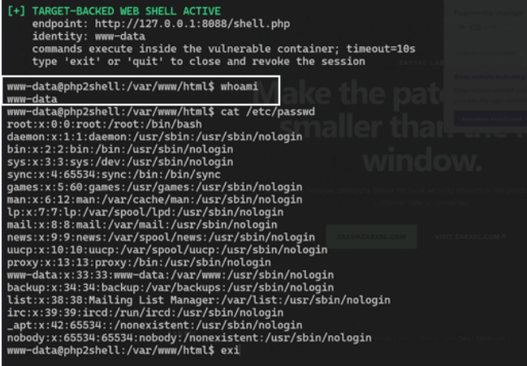

# Task 4 — PHP2Shell Vulnerability Validation Lab

## 1. Overview

This laboratory assessment investigates two critical PHP vulnerabilities associated with remote code execution (RCE):

- **CVE-2026-109618** — RCE via OOM Corruption
- **CVE-2026-109619** — RCE via Stale Global State

The objective was to validate the existing proof-of-concept (PoC) implementations, analyze their underlying mechanisms, demonstrate controlled proof of execution, and compare vulnerable, patched, and mitigated PHP configurations.

The assessment was performed using PentAGI against a localized Docker laboratory environment hosted in the `~/php2shell` repository.

All exploitation and RCE validation were restricted to the disposable local laboratory.

## 2. Objectives

- Verify laboratory environment readiness.
- Analyze the existing PoCs and associated source code.
- Understand the memory corruption and stale-state vulnerability mechanisms.
- Validate RCE against the vulnerable PHP configuration.
- Compare vulnerable, patched, and mitigated environments.
- Collect execution evidence and reproducibility information.
- Evaluate the effectiveness of upstream patches and temporary mitigations.
- Produce a technical assessment supported by laboratory evidence.

## 3. Laboratory Environment

| Component | Configuration |
|---|---|
| Platform | Linux / WSL2 |
| Containerization | Docker Engine and Docker Compose |
| Web Server | Apache HTTP Server |
| PHP SAPI | Apache mod_php |
| Architecture | amd64 |
| Repository | `~/php2shell` |
| Assessment Agent | PentAGI |
| Target Application | Zarxec Lab |
| Primary Target | `127.0.0.1:8088` |
| Network Scope | Loopback only |

### 3.1 Target Matrix

| Variant | Endpoint | PHP Version | Configuration | Assessment Result |
|---|---|---|---|---|
| Vulnerable | `127.0.0.1:8088` | 8.4.26 | Constrained memory configuration | RCE reported as verified |
| Patched | `127.0.0.1:8089` | 8.4.27 | Upstream security patch | RCE not observed |
| Mitigated | `127.0.0.1:8090` | 8.4.26 | Upload progress disabled and unlimited PHP memory | RCE not observed |

All three services are configured to bind to `127.0.0.1`.

The patched and mitigated variants act as negative controls for comparative validation.

## 4. Assessment Methodology

### Phase 1 — Environment Readiness and Container Startup

The assessment began with verification of the Docker environment and laboratory services.

Activities included:

- Inspection of Docker availability.
- Verification of the laboratory repository.
- Confirmation of the three target endpoints.
- Verification of the vulnerable, patched, and mitigated configurations.
- Collection of runtime and container status information.

The endpoints were treated as independent laboratory targets.

### Phase 2 — PoC and Source Code Analysis

The existing PoC implementations and associated source code were reviewed to understand the vulnerability prerequisites and expected behavior.

#### CVE-2026-109618 — OOM Corruption

The vulnerability concerns PHP's handling of out-of-memory conditions during request processing.

The analysis focused on:

- Memory exhaustion during multipart request parsing.
- Unsafe early termination of request processing.
- Incomplete request-state initialization.
- Invalid state being consumed during request shutdown.
- The potential for memory corruption to result in control-flow hijacking.

#### CVE-2026-109619 — Stale Global State

The vulnerability concerns request-owned memory retained through persistent global state across worker requests.

The analysis focused on:

- Request memory lifecycle.
- Persistent worker behavior.
- Stale references surviving request cleanup.
- Session upload progress lifecycle.
- Producer and consumer operations across separate requests.
- The potential for use-after-free conditions to result in RCE.

### Phase 3 — Vulnerability and RCE Verification

PentAGI reported successful controlled proof-of-execution validation against the vulnerable target.

The reported execution context was:

`www-data`

The results indicated that the existing PoCs demonstrated command execution under the privileges of the Apache web server account.

No root privileges, container escape, or host compromise were claimed.

### Phase 4 — Control Variant Comparison

The vulnerable target was compared with the patched and mitigated variants.

| CVE | Vulnerable PHP 8.4.26 | Patched PHP 8.4.27 | Mitigated PHP 8.4.26 |
|---|---|---|---|
| CVE-2026-109618 | RCE reported | RCE not observed | RCE not observed |
| CVE-2026-109619 | RCE reported | RCE not observed | RCE not observed |

The results indicate that the upstream patch and laboratory configuration mitigations reduced or prevented the observed exploitation behavior.

The mitigated configuration is not considered equivalent to the complete upstream patch.

### Phase 5 — Final Assessment and Technical Reporting

The final assessment consolidated:

- Environment readiness.
- Source code analysis.
- Vulnerability prerequisites.
- Reported RCE evidence.
- Control variant comparison.
- Reproducibility.
- Confidence levels.
- Remediation recommendations.

## 5. Results

### CVE-2026-109618 — RCE via OOM Corruption

| Assessment Attribute | Result |
|---|---|
| PoC Status | CONFIRMED |
| Vulnerable Target | PHP 8.4.26 |
| Target Endpoint | `127.0.0.1:8088` |
| RCE Status | Reported as verified |
| Patched Target | PHP 8.4.27 — RCE not observed |
| Mitigated Target | PHP 8.4.26 — RCE not observed |
| Reproducibility | Reported high |
| Confidence | High, based on supplied mission results |

#### Root Cause

The vulnerability involves unsafe handling of out-of-memory conditions in PHP request processing.

An allocation failure may cause an early exit while request memory is incompletely initialized. Subsequent request shutdown handling may consume invalid state, resulting in memory corruption and potential remote code execution.

#### Evidence

PentAGI's reported evidence includes:

- Successful execution proof on the vulnerable target.
- Execution under the Apache `www-data` account.

- Comparative testing against patched and mitigated controls.

### CVE-2026-109619 — RCE via Stale Global State

| Assessment Attribute | Result |
|---|---|
| PoC Status | CONFIRMED |
| Vulnerable Target | PHP 8.4.26 |
| Target Endpoint | `127.0.0.1:8088` |
| RCE Status | Reported as verified |
| Patched Target | PHP 8.4.27 — RCE not observed |
| Mitigated Target | PHP 8.4.26 — RCE not observed |
| Reproducibility | Reported high |
| Confidence | High, based on supplied mission results |

#### Root Cause

The vulnerability involves stale references to request-owned memory retained in persistent PHP worker state.

A previous request may leave global state pointing to memory that has already been released. A subsequent request can consume that stale reference before normal initialization resets it, resulting in use-after-free conditions and potential remote code execution.

#### Evidence

PentAGI's reported evidence includes:

- Successful execution proof on the vulnerable target.
- Source analysis documents: `01-lifetime.md`, `06-bgctx-serializer.md`, `11-official-patch.md`, and `17-verification.md`.
- Comparative testing against patched and mitigated configurations.

## 6. Reproducibility and Confidence

PentAGI reported high reproducibility for both vulnerabilities against the pinned PHP 8.4.26 Apache mod_php laboratory.

The supplied mission summary reports successful vulnerable-target execution and negative results against the patched and mitigated controls.

Confidence is based on the reported evidence and source analysis. The underlying logs, proof artifacts, and verification files should be retained for independent audit.

## 7. Remediation

The recommended remediation is to upgrade to a PHP release containing the upstream security patches.

| PHP Branch | First Fixed Release |
|---|---|
| PHP 8.2 | 8.2.35 |
| PHP 8.3 | 8.3.36 |
| PHP 8.4 | 8.4.27 |
| PHP 8.5 | 8.5.12 |

Additional defensive measures include:

- Disabling unnecessary session upload progress functionality.
- Applying conservative request-size limits.
- Reviewing multipart parsing configuration.
- Monitoring abnormal PHP worker behavior.
- Restarting all affected PHP workers after patching.
- Verifying the effective PHP web SAPI and installed package version.

Temporary configuration mitigations are not a replacement for the complete upstream security fix.

## 8. Conclusion

The PHP2Shell laboratory assessment was reported as successfully completed.

PentAGI reported that both CVE-2026-109618 and CVE-2026-109619 PoCs demonstrated RCE against the vulnerable PHP 8.4.26 Apache mod_php environment.

The patched PHP 8.4.27 and mitigated PHP 8.4.26 configurations did not demonstrate the same execution behavior.

The laboratory provides a controlled foundation for understanding PHP request lifecycle vulnerabilities, validating security patches, and studying defensive mitigation strategies.

All exploit validation remained restricted to the isolated local laboratory.
